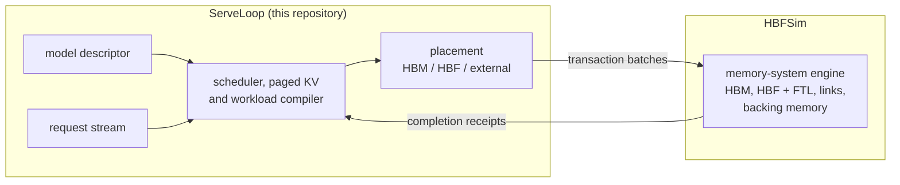

# ServeLoop

**The LLM-serving frontend for [HBFSim](https://github.com/FlashLabAE/HBFSim).**

[](https://github.com/FlashLabAE/ServeLoop/actions/workflows/ci.yml)
[](LICENSE)


[Quick start](#quick-start) ·
[Working with HBFSim](#working-with-hbfsim) ·
[What is modeled](#what-is-modeled) ·
[Documentation](#documentation) ·
[Contributing](CONTRIBUTING.md)

ServeLoop turns a model descriptor and a request stream into what an LLM
server does to memory: continuous-batching iterations, paged-KV allocation and
eviction, and byte-exact weight and KV transactions. HBFSim executes those
transactions on a simulated memory system (HBM, High-Bandwidth Flash and
external memory) and returns their completion times, which ServeLoop's
scheduler uses to plan the next iteration. Together the two close the loop
between a serving workload and the memory hierarchy underneath it.

ServeLoop is a workload simulator, not an inference engine. It runs no model,
needs no GPU and has no Python dependencies. Every result labels synthetic
inputs as synthetic, hashes its source artifacts, derives model bytes from
explicit formulas, and carries a machine-readable capability boundary.

## How the two projects fit together



| | ServeLoop | HBFSim |
| --- | --- | --- |
| Owns | models, requests, scheduler, paged KV, prefix cache, placement, compute timing, fixed-window experiments | hardware profiles, physical timing, flash translation, garbage collection, wear, the `hbfsim_client` protocol |
| Built with | Python 3.10+, no dependencies | C++20 engine with a Python front door |
| Useful alone for | converting models, generating requests, checking experiments before a run | replaying traces, sweeping hardware, prototyping memory policies |

HBFSim never sees a model or a request, and ServeLoop never infers a flash
plane or a device timing from an address: the engine sees transactions, the
frontend sees latency.

## Quick start

Clone the two repositories side by side and build HBFSim. You need CMake
3.20+, a C++20 compiler and Python 3.10 or newer; on macOS, `/usr/bin/python3`
is Python 3.9, so install a newer Python (from python.org or Homebrew) first.

```bash
git clone https://github.com/FlashLabAE/HBFSim.git
git clone https://github.com/FlashLabAE/ServeLoop.git
cd HBFSim
python3 -m hbfsim doctor    # checks the toolchain and finds ../ServeLoop
python3 -m hbfsim build
```

Then serve eight synthetic requests (256-token prompts, 32 output tokens each)
on four HBM and four HBF stacks, with weights in HBF and the KV cache in HBM:

```bash
export PYTHONPATH="$PWD:../ServeLoop${PYTHONPATH:+:$PYTHONPATH}"
python3 -B -m serveloop run \
  --model ../ServeLoop/models/llama31-8b-w8-kv-bf16.json \
  --system configs/systems/miniquick/4hbm-4hbf.cfg \
  --requests ../ServeLoop/examples/quickstart-requests.json \
  --placement weights-hbf-kv-hbm \
  --simulator build/hbfsim \
  --out out/serveloop-quickstart
```

The run takes about a minute and ends with a summary:

```text
iterations: 33 (prefill 1, decode 31, mixed 1); preemptions: 0; KV migrated out/in: 0 B / 0 B
TTFT mean 43.436 ms (p50 47.964 ms, p95 50.366 ms); TPOT mean 7.341 ms (p50 7.196 ms, p95 8.358 ms)
output throughput 935.4 tokens/s; span 273.665 ms
bytes: HBM R 10.74 GB / W 300.94 MB; HBF R 247.73 GB / W 0 B; external R 0 B / W 0 B
HBF WAF: n/a (no HBF writes); warnings: synthetic requests
```

The latencies follow the declared roofline compute assumptions; they are not
hardware predictions. From here, `--placement all-hbm` gives the HBM-only
reference, `--placement weights-hbf-kv-hbf-cold` lets cold KV move to HBF when
HBM runs short (these eight requests fit in HBM, so nothing moves), and
`--system configs/systems/miniquick/2hbm-6hbf.cfg` (or `6hbm-2hbf.cfg`) changes
the HBM:HBF ratio. Each run writes a new timestamped directory with its
canonical inputs, SHA-256 identities, per-iteration schedules, per-request
latencies and physical completions; earlier results are never overwritten.

## Working with HBFSim

### Two ways to run

**From the HBFSim checkout**, as in the quick start. This is the recommended
setup: HBFSim's own `hbfsim_client` and system profiles are used, so the client
always matches the engine you built. HBFSim's
[ServeLoop guide](https://github.com/FlashLabAE/HBFSim/blob/main/docs/guides/serveloop.md)
explains what crosses the boundary between the two.

**As an installed package**, which suits work on ServeLoop itself:

```bash
cd ServeLoop
python3 -m venv .venv
source .venv/bin/activate
python3 -m pip install -e .
serveloop run --simulator ../HBFSim/build/hbfsim \
  --model models/llama31-8b-w8-kv-bf16.json \
  --system configs/systems/miniquick/4hbm-4hbf.cfg \
  --requests examples/quickstart-requests.json \
  --placement weights-hbf-kv-hbm \
  --out out/quickstart
```

This uses ServeLoop's bundled copies of `hbfsim_client` and of HBFSim's system
profiles. With the HBFSim commit they were copied from, both ways produce
identical results.

### Keeping versions in step

The client and the engine change together, so pair their versions on purpose:

| What | Where it is pinned |
| --- | --- |
| HBFSim commit that ServeLoop's bundled client and profiles copy | `0e46ac0`, see [backend compatibility](docs/configuration.md#backend-compatibility) |
| Oldest ServeLoop that HBFSim's tests accept | `HBFSIM_SERVELOOP_MIN_REVISION` in HBFSim's `CMakeLists.txt` |
| ServeLoop revision that HBFSim's CI tests | `SERVELOOP_REVISION` in HBFSim's `.github/workflows/ci.yml` |

`configs/systems/` here has the same file names and contents as HBFSim's, so a
command names a profile the same way from either directory. The engine rejects
any configuration key it does not own, so a mismatched profile fails at
startup instead of running with ignored settings. HBFSim finds ServeLoop at
`../ServeLoop` or `$SERVELOOP_ROOT`; for its `serveloop`-labelled tests,
configure HBFSim with `-DHBFSIM_SERVELOOP_SOURCE_DIR=/path/to/ServeLoop` to use
another location.

### Without a simulator

Model conversion, request generation and experiment checks need no HBFSim
build:

```bash
serveloop capabilities      # the machine-readable fidelity boundary
serveloop model models/llama31-8b-w8-kv-bf16.json --output out/llama31-8b.json
serveloop generate --config examples/quickstart-requests.json --output out/requests.json
serveloop run --experiment configs/windows/miniquick-serving.json \
  --preflight-only --out out/window-check
```

The last command generates a fixed memory window and validates its whole
topology matrix. For physical execution, replace `--preflight-only` with
`--simulator ../HBFSim/build/hbfsim --topologies all-hbm,4h4f`; the all-HBM
row takes seconds, the 4h4f row about a quarter of an hour on a laptop. Add
`--allow-dirty` to run from a modified or non-Git installation. See
[Fixed windows](docs/windows.md) for the modes, profiles and how to read them.

## What is modeled

- Dense, MoE, and multi-model request streams.
- Token-budgeted continuous batching with chunked prefill and decode.
- Incremental 16-token paged KV allocation, migration, preemption, and
  recomputation.
- Content-addressed full-block prefix reuse with a bounded, reference-counted
  HBM cache, LRU pressure eviction, and optional TTL
  ([prefix caching](docs/prefix-caching.md)).
- Object-exact weight, embedding, LM-head, block-table, and KV traffic.
- HBM, HBF, and external-memory placement with byte-conservation receipts.
- Roofline, memory-only, or linear compute timing, and calibrated paged GPU
  operators when you supply a measured operator profile
  ([calibrated GPU operators](docs/configuration.md#calibrated-gpu-operators)).
- A100 application-address templates for paged FA2 KV and supported small-M
  Marlin QKV ([GPU address model](docs/gpu-address-model.md)).
- A persistent HBFSim session whose completion frontier schedules the next
  iteration.
- Decode snapshots: an exact logical replay of a long stream on a declared
  clock, with decode-only stretches advanced in one step, exports the state of
  a representative iteration, and a timed run resumes from it
  ([snapshots](docs/snapshots.md)).
- Sampled windows: only a share of the iterations is timed in full, the rest
  keep their writes and take their stratum's mean, and the window is reported
  with a confidence interval ([sampling](docs/sampling.md)).
- Matched fixed-window topology comparisons: prefill growth, decode-only, and
  source-anchored mixed windows, with no compute timing or request feedback.

ServeLoop currently models one device and no collective or network timing. It
does not claim kernel-level cache behavior or hardware-calibrated end-to-end
latency unless those are supplied and validated by a trace or calibration
backend. `serveloop capabilities` prints the exact current boundary.

### Why the workload is credible

ServeLoop separates four questions that benchmarks often conflate:

1. **Input realism:** request arrivals, prompt/output lengths, token IDs, and
   MoE routes are either source-qualified traces or explicitly synthetic.
2. **Semantic realism:** in closed-loop mode, the scheduler and paged-KV state
   machine operate on individual requests and tokens rather than a fixed
   bandwidth loop.
3. **Traffic realism:** model dimensions and precision produce an auditable
   per-object byte ledger; mapping must conserve those bytes exactly.
4. **Timing realism:** timing is named by backend. Roofline and simulation are
   models, not measurements; hardware claims require calibration and holdout
   validation.

[Realism and trace integration](docs/realism.md) describes the path from a
serving profiler to cache-line address and arrival traces.

### Optional paths

- [Enhanced coarse generation](docs/coarse-enhanced.md) adds model-derived
  activation and intermediate footprints without GPU capture, with an optional
  finite range cache for cache-policy sensitivity studies. Both are opt-in
  workload approximations.
- The [native SGLang frontend](docs/sglang.md) (`python -m serveloop.sglang`)
  runs SGLang's own scheduler, RadixCache and token allocator for studies that
  need them. It has separate dependencies and is never selected by
  `serveloop run`. Both frontends use HBFSim's physical engine; switching
  changes scheduling and allocation, not the memory model.
- The `serveloop.recovery` API models committed-boundary HBF media and KV
  recovery for HBFSim's bounded resident-KV studies. It does not model
  scheduler resume or persistent prefix caching.

## Documentation

| Topic | Document |
| --- | --- |
| Architecture and contracts | [Design](docs/design.md) |
| Profiles, HBFSim compatibility, GPU operator timing | [Configuration](docs/configuration.md) |
| Fixed memory windows | [Windows](docs/windows.md) |
| Prefix caching | [Prefix caching](docs/prefix-caching.md) |
| Decode snapshots and logical replay | [Snapshots](docs/snapshots.md) |
| Sampled windows | [Sampling](docs/sampling.md) |
| From profiler traces to address traces | [Realism](docs/realism.md) |
| Coarse traces | [Enhanced coarse](docs/coarse-enhanced.md), [operator coverage](docs/coarse-coverage.md), [complete-model measurements](docs/coarse-evidence.md) |
| GPU application addresses | [GPU address model](docs/gpu-address-model.md) |
| Native SGLang | [SGLang](docs/sglang.md) |

## Repository layout

- `serveloop/`: request semantics, scheduler, compiler, placement, and CLI.
- `serveloop/windows/`: deterministic fixed-population windows and address
  remapping.
- `serveloop/sglang/`: the optional native SGLang frontend.
- `hbfsim_client/`: HBFSim's persistent-session client, copied from HBFSim.
- `models/`: public, source-attributed architecture descriptors.
- `examples/`: deterministic synthetic fixtures and quick-start inputs.
- `configs/systems/`: HBFSim's system profiles, copied from HBFSim.
- `configs/overlays/`, `configs/windows/`: backing, capacity and thermal
  overlays and the fixed-window experiments.
- `tests/`: contract, scheduler, accounting, and physical integration tests.

## Tests

The self-contained suites need no simulator:

```bash
python3 -B tests/test_serveloop.py
python3 -B tests/test_windows.py
python3 -B tests/test_session_compatibility.py
python3 -B tests/test_recovery.py
```

With an HBFSim build, these suites also execute small physical sessions:

```bash
for suite in serveloop windows session_compatibility prefix peer tiering; do
  python3 -B tests/test_$suite.py --simulator ../HBFSim/build/hbfsim
done
python3 -B tests/test_config_compatibility.py \
  --hbfsim-root ../HBFSim --simulator ../HBFSim/build/hbfsim
```

These do not execute the full miniquick or full-scale physical matrix.

## Citing

ServeLoop is the serving frontend described in the HBFSim paper. If it helps
your research, please cite:

```bibtex
@inproceedings{li2026hbfsim,
  author    = {Li, Jinheng and Wang, Guosheng and Du, Hongchao and Wu, Shangyu and Li, Qiao and Xue, Chun Jason},
  title     = {{HBFSim}: A Simulator for Exploring {HBF} in Memory Hierarchies for {LLMs}},
  booktitle = {International Conference on Resilience, AI and Cyber-Systems (RACS '26)},
  year      = {2026},
  address   = {Fukuoka, Japan},
  publisher = {ACM},
  doi       = {10.1145/3848591.3856870}
}
```

## Maturity and license

ServeLoop is alpha software. Schemas are versioned, but compatibility is not
yet promised. ServeLoop is distributed under the [MIT License](LICENSE);
[NOTICE.md](NOTICE.md) records which files are copied from HBFSim.
